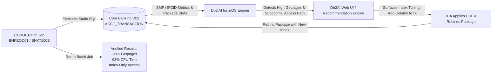

# Db2 AI for z/OS Client Demonstration Runbook
**Workload Scenario:** End-of-Day (EOD) Core Banking Batch Optimization  
**Repository:** [AMEQUI/db2zai-banking-demo](https://github.com/AMEQUI/db2zai-banking-demo)

---

## 1. Executive Summary & Architecture Overview

### Business Context
Core banking batch processing operates inside strict overnight Service Level Agreements (SLAs). Inefficient access paths in static SQL packages increase CPU consumption (MSUs/MIPS), inflate buffer pool getpages, and risk missing the batch processing window.

### Demonstration Objective
Showcase how **Db2 AI for z/OS (Db2ZAI)** identifies an inefficient access path in a production COBOL static batch package, provides an actionable AI-driven index tuning recommendation, and verifies significant performance improvements (Getpages, CPU, and Elapsed time) following a package rebind.

---

## 2. Walkthrough Steps

### Step 1: Baseline Workload & Bottleneck Detection
* **Objective:** Show how Db2 AI for z/OS flags `COL_BANKING.BNK7100B` Stmt #420.
* **Key Metric:** 2.48M getpages, 47.10s elapsed time.
* **Root Cause:** `INDEXONLY = 'N'`, requiring synchronous table data page reads.

### Step 2: AI Tuning Recommendation
* **Objective:** Surface recommendation `REC-2026-IX04`.
* **Action:** Extend index with `STATUS_CODE` and `TXN_AMOUNT`.

### Step 3: DDL Application & Package Rebind
* **Objective:** Apply DDL and trigger `REBIND PACKAGE(COL_BANKING.BNK7100B) EXPLAIN(YES)`.
* **Talking Point:** Zero application source code modifications.

### Step 4: Before/After Proof
* **Getpages:** 2,480,120 &rarr; 44,210 (**-98.2%**)
* **CPU Time:** 18.42s &rarr; 1.18s (**-93.6%**)
* **Elapsed Time:** 47.10s &rarr; 3.05s (**-93.5%**)
